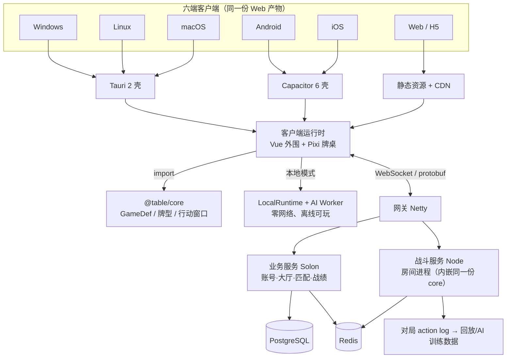
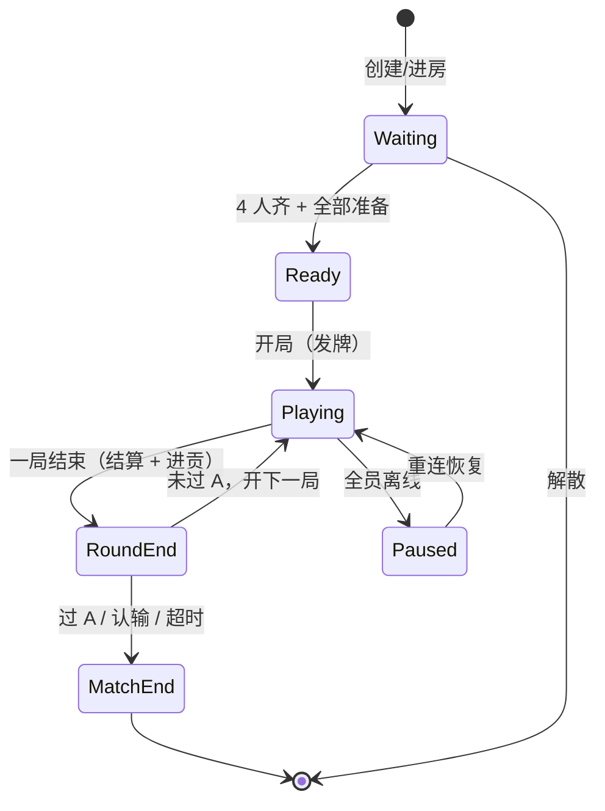
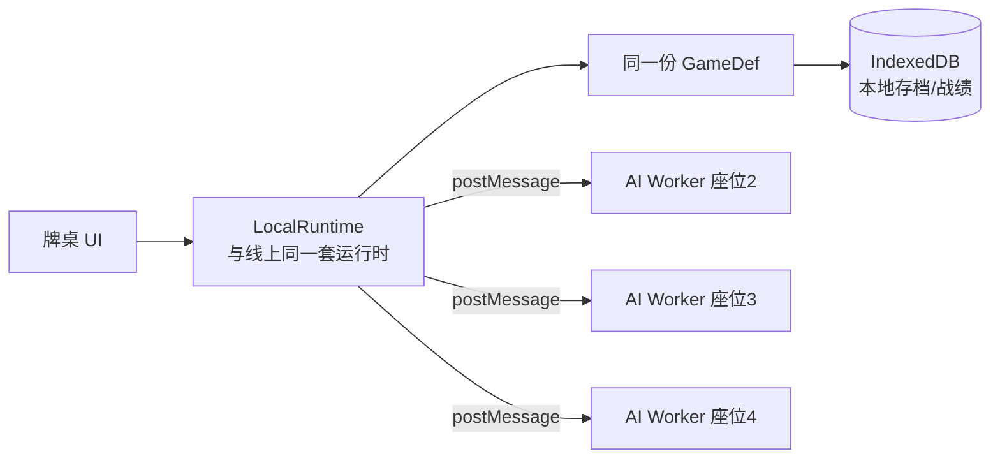
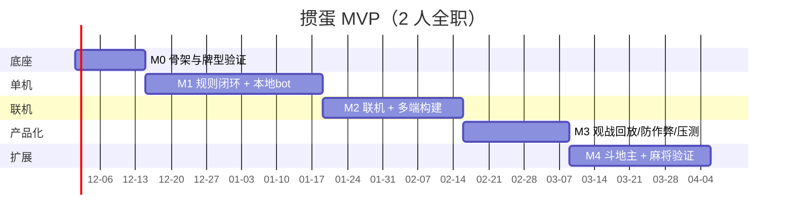

# 掼蛋多端游戏开发计划

> 版本 v1.0 · 2026-11-23 · 目标：一套可复用的棋牌框架，首发掼蛋，后续可插拔斗地主、麻将
>
> 本文档按"2 人全职（1 客户端 + 1 服务端）"估算排期；单人全职约 1.6～1.8 倍周期，4 人团队可压缩到 10～11 周（并行做视图与后台）。

---

## 0. 结论先行：三条决定成败的架构选择

**① 规则引擎必须"单源同构"。** 掼蛋的规则复杂度（级牌、逢人配百搭、进贡还贡、四王炸、同花顺与炸弹的序、接风、升级档位）远超普通牌局。如果客户端写一份、服务端再写一份，一定会在三个月后出现"本地 bot 打得通、线上判非法"的经典事故。所以规则引擎只写一次，用纯函数、确定性、零 I/O 的 TypeScript 包 `@table/core`，浏览器、Tauri、Capacitor、Node 服务端跑的是同一份代码。

**② 对局运行时与玩法规则分离。** "准备、发牌、轮转、超时托管、断线重连、旁观、回放"这些东西和掼蛋无关，和斗地主、麻将也无关，属于框架层。玩法只提供一份 `GameDef` 契约。这条决定了后期加斗地主是"新增 1 个目录"还是"重构半个项目"。

**③ 区分"一局"和"一场"。** 掼蛋的计分单位是"一场打到过 A"，中间有多付牌和局间进贡；斗地主是"3 局 2 胜"；麻将是"一圈/四圈"。运行时从一开始就要有 `Match`（多局循环 + 累积分）和 `Round`（单付牌）两层，否则做到 M3 会推倒重来。

---

## 1. 范围边界

**首版做：**

- 掼蛋 4 人 2v2 完整规则（含进贡/还贡/抗贡、升级、过 A 判定）
- 联机对战（房间码 + 匹配）、断线重连、托管
- 本地 bot 陪玩（离线可玩，人机混合房显式标注）
- 观战、对局回放、战绩
- 六端产物：Windows / Linux / macOS / Android / iOS / Web+H5

**首版不做（明确写下来，避免范围蔓延）：**

- 充值、商城、皮肤付费
- 赛事/赛季/战队系统
- 语音、3D 牌桌、物理动效
- 反作弊的人工审核后台（只做数据留痕 + 自动告警）
- AI 强化学习训练闭环（只留接口）

**合规前置提醒：** 国内 iOS / Android 商店上架牌类游戏需要版号与备案，周期和不确定性很高。建议首发只走 **Web + H5 + 桌面端自主分发** 验证玩法与留存，公众商业化前再启动版号流程；不要把它排在"上线前两周"。

---

## 2. 技术选型与取舍

### 2.1 推荐方案（A 案）

| 层 | 选型 | 理由 |
|---|---|---|
| 业务服务 | Java 21 + Solon 3 | 账号、大厅、匹配、社交、支付、后台；你的主力栈 |
| 实时网关 | Netty（Solon 内嵌） | WebSocket 长连接、心跳、限流 |
| 战斗服务 | Node.js 22 + TypeScript | 直接 `import` 同一份规则引擎，房间进程内嵌，无跨语言序列化 |
| 规则引擎 | TypeScript，纯函数 | 客户端/服务端/回放/AI 四方复用，浏览器与 Node 行为一致 |
| 客户端 | Vue 3 + Vite + Pinia（外围）+ PixiJS 8（牌桌） | Vue 管大厅/设置/结算，Pixi 管牌、拖拽、动画 |
| 桌面壳 | Tauri 2 | 产物 10～20MB，可自动更新，你已熟悉 Rust 侧 |
| 移动壳 | Capacitor 6 | 复用同一份 Web 产物，原生能力（震动/分享/内购）按需桥接 |
| 协议 | protobuf（buf 生成 TS + Java DTO） | 一份 schema 两端类型，避免手写字段漂移 |
| 存储 | PostgreSQL 16 + Redis 7 | PG 存账号/战绩/经济，Redis 存房间快照/匹配队列/会话 |
| 观测 | Prometheus + 结构化日志 + 对局 trace | 关键：异常对局能一键导出回放 |

### 2.2 为什么不选另外两条路

- **全 Java 单语言（引擎用 GraalJS 跑 TS）**：省一个进程，但 GraalJS 冷启动和体积都不适合"单机本地玩"，客户端还是得再来一份，直接违背单源原则。否决。
- **引擎用 Rust，客户端 wasm、服务端 native（JNI/Panama）**：性能与包体最优，规则也单源。但 Java↔Rust 的 FFI 边界、wasm 内存管理、调试链路成本高，对棋牌这种"每 2 秒一次动作"的负载是过度设计。**B 案备用**：如果后续要上高并发赛事或要做强 AI 搜索，再迁移（因为 `GameDef` 契约不变，迁移是替换实现而非重写）。

### 2.3 分阶段引入，别一次上全

M0～M2 阶段让 Node 一肩挑"网关 + 房间"，Java 只在大厅与账号需要时才接入。等联机链路稳定（M2 结束）再把网关/业务迁到 Java。这样可以避免第一天就在两个语言之间的会话态、鉴权、序列化上耗掉两周。

---

## 3. 架构总览



**数据流原则：服务端权威。** 客户端只做"乐观出牌动画"，服务端回执后以服务端状态为准并可回滚；任何合法性判定、计时、发牌、结算都在服务端完成。

---

## 4. 通用框架设计（扩展性的真正所在）

### 4.1 `GameDef` 契约

玩法只实现这一个接口，运行时负责其余一切。

```ts
export interface GameDef<S, A, V> {
  readonly id: string;                    // 'guandan' | 'doudizhu' | 'mahjong'
  readonly meta: { minSeats: number; maxSeats: number; teams: boolean };

  createInitialState(ctx: CreateCtx): S;  // ctx 内含注入的 RNG 与规则配置
  pendingSeats(state: S): SeatId[];       // 关键：允许"多座位同时可行动"
  legalActions(state: S, seat: SeatId): A[];
  isLegal(state: S, seat: SeatId, action: A): boolean;
  apply(ctx: ApplyCtx, state: S, action: A): { next: S; events: GameEvent[] };
  viewFor(state: S, seat: SeatId): V;     // 私有信息裁剪，防透视的地基
  isFinished(state: S): boolean;
  settle(state: S): Settlement;
  metrics?(state: S): Record<string, number>; // 给 AI 用的特征
}
```

**`pendingSeats` 返回集合而不是单个座位，是刻意为麻将留的口子。** 掼蛋是严格的单向轮流出牌，麻将却有"吃碰杠胡"的响应窗口，甚至一炮多响需要优先级仲裁。如果一开始把运行时写成"轮到谁谁出牌"的单人状态机，加麻将时必然重写调度层。

**并发裁决仍由玩法负责**，运行时只负责：收集窗口内的动作、超时兜底、保证裁决只依赖 `(state, 已收集动作集合, RNG)`，从而保持可重放。

### 4.2 下沉到框架层的通用能力

| 能力 | 说明 | 受益玩法 |
|---|---|---|
| Card / Deck / Zone | 牌对象（花色、点数、副牌编号）、牌堆/手牌/弃牌区/桌面区 | 全部 |
| Pattern 牌型系统 | 识别 + 比较 + 排序，支持"通配符感知"的比较（掼蛋逢人配必需） | 掼蛋、斗地主 |
| HandDecomposition 手牌拆解 | 把一手牌枚举成最少手数/最高牌力的组合，DP + 剪枝 | 掼蛋、斗地主、麻将向听 |
| ActionWindow | 多座位响应窗口 + 优先级 + 截止时间 | 麻将（必需）、斗地主（叫分） |
| TurnScheduler | 顺时针/逆时针、跳位、连续过牌判定、接风类特殊轮转 | 掼蛋、斗地主 |
| Match / Round | 多局循环、局间状态（进贡、换牌）、累积分、赛制 | 全部 |
| View 裁剪 | 按座位生成可见视图，服务端只下发该视图 | 全部（防作弊） |
| Replay | `{seed, config, seats, actions[]}` 确定性重放 | 全部 |
| Seat 生命周期 | 入座/离开/托管/断线/重连/旁观/踢人 | 全部 |
| Settlement | 统一结算结构（名次、分数变动、经验） | 全部 |

### 4.3 确定性红线

引擎内**禁止**出现 `Math.random()`、`Date.now()`、`new Date()`、依赖插入顺序的 Map 遍历、以及任何 I/O。所有随机来自注入的 PCG 种子，所有时间由运行时在事件里带入。这条红线保证：

- 同一条 action log 在 Node 与浏览器里算出同一状态哈希 → 双端一致性可自动化验证
- 断线重连只需下发快照 + seq，客户端可校验 `stateHash`
- 回放、投诉复盘、AI 训练数据全部零成本

---

## 5. 掼蛋规则引擎

### 5.1 必须实现的规则项

- 108 张双副牌，4 人 2v2，对家为搭档
- 级牌体系：2 → A 逐级上升；当前级牌与红桃级牌（逢人配）的牌力定位
- 逢人配（百搭）：可替代除大小王外任意牌，参与对子/三张/顺子/连对/钢板/炸弹/同花顺的构造
- 牌型：单张、对子、三张、三带二、顺子（5 张）、三连对（木板）、钢板（两连三张）、炸弹（4～8 张同点）、同花顺、四王炸
- 大小关系：同牌型同张数比大小；炸弹跨牌型压制；炸弹内部与同花顺、四王炸的完整序列
- 轮转：连续过牌后由最后出牌者继续；头游出完后的接风
- 进贡 / 还贡 / 抗贡（双大王）
- 升级档位：双下、1&3、1&4 各自升几级
- 过 A 规则（打 A 的限制与失败回退）
- 一局结算 → 下一局发牌（含进贡后的手牌状态）

### 5.2 规则配置化，而不是硬编码

掼蛋地方差异极大，同一套代码必须能开不同桌子。

```ts
interface GuandanConfig {
  decks: 2;
  wildcard: 'heart-level' | 'none';
  bombOrder: '4<5<sf<6<7<8<bomb-joker';   // 同花顺与 5 炸/6 炸的相对位置各地不同
  straightFlushBeatsBombCount: 5;         // 同花顺可压到几炸
  tribute: { enabled: boolean; antiTribute: 'two-jokers' | 'one-big-one-small'; returnMaxRank: '10' };
  passLevel: 'double-down-only' | 'any-win';  // 过 A 条件
  mustPlayAll?: boolean;
}
```

配置随对局写入回放头与 `schemaVersion`，否则规则改了以后老回放放不出来。

### 5.3 需要跟真实玩家确认的清单（最大风险源）

规则歧义通常是棋牌项目 30% 的工时黑洞。动工前先拉一次真人打法对齐，逐条落成配置项：

1. 同花顺到底压在 5 炸之上还是 6 炸之下？各地口径不一
2. 逢人配能否参与组成同花顺？能否当王用？
3. 进贡是否禁止进红桃级牌？还贡上限是 10 还是 9？
4. 抗贡条件是一对大王，还是"任意两张王"？
5. 头游出完后，接风是"对家直接接"还是"其余人都过再对家接"？
6. 双下升 3 级、1&3 升 2 级、1&4 升 1 级是否为你需要的版本？
7. 打 A 时必须双下才算过 A，还是拿到头游即可？三次不过 A 是否回退到 2？
8. 末游是否需要向头游进贡两张（部分玩法有"双贡"）？
9. 最后剩 1 张牌时的报单提示是否强制？
10. 有无"三带二"必须带对子（不能带两张散牌）的限制？

建议做法：把这张清单做成表，每条给出 2～3 个候选口径 + 截图/口述记录，确认后写进 `GuandanConfig` 默认值，并同步进 `docs/规则baseline.md`。

---

## 6. 服务端设计

### 6.1 服务划分

- **网关（Java/Netty）**：连接管理、鉴权、限流、心跳、协议编解码、路由到房间
- **业务（Java/Solon）**：注册登录、资料、好友、房间大厅列表、匹配、战绩、举报、后台
- **战斗（Node/TS）**：房间运行时。单进程承载多房间，房间状态除快照外不落库；按房间数水平扩容

### 6.2 房间生命周期



### 6.3 同步与容错

| 场景 | 策略 |
|---|---|
| 正常出牌 | 客户端乐观动画 → 服务端回执 `seq + stateHash` → 不一致则全量纠正 |
| 断线重连 | 服务端保留每座位"裁剪视图增量环形缓冲（最近 200 条）"，重连下发快照 + `fromSeq` 增量 |
| 超时 | 15s 倒计时，超时 1 次自动"过"，连续 2 次进入托管；托管期间用同一份 AI（仅用裁剪视图） |
| 服务重启 | 房间快照（Redis，30s 一次 + 关键节点强制）恢复；无法恢复则整场判"流局不计分" |
| 并发动作（未来麻将） | 行动窗口收集 + 优先级仲裁 + 窗口超时兜底 |

### 6.4 反作弊底线

- 服务端**只下发 `viewFor(seat)` 的裁剪视图**，任何人都拿不到别人的手牌，客户端代码里不存在"全部手牌"这个对象
- 合法性、计时、发牌、结算全部服务端判定；客户端提交的任何字段都按不可信处理
- 记牌器类外挂本质上只能靠"历史公开信息"实现，这是合规能力，不做封堵
- 异常行为打点：出牌耗时分布、连胜异常、多账号同 IP、客户端篡改（`stateHash` 不匹配计数）→ 触发告警并保留完整回放

### 6.5 关键协议草案

```proto
// 客户端 → 服务端
message PlayAction { string matchId; int32 seat; int32 seq; string patternId; repeated int32 cardIds; }
// 服务端 → 客户端
message SeatView   { int32 seat; repeated int32 handCards; repeated int32 publicCards; int32 remaining; }
message StateSync  { string matchId; int32 seq; bytes view; string stateHash; repeated Event events; }
message RoundResult{ int32 firstSeat; int32 secondSeat; int32 levelDelta; repeated Tribute tributes; }
```

控制类消息（登录、进房、聊天）用 JSON 便于调试；战斗帧用 protobuf 二进制。

### 6.6 容量估算（需压测验证，不是承诺）

单房间 4 连接、人均 3～5 秒一次动作，纯转发极其轻。经验区间：单核 2000～5000 房间；开启 bot 托管或 AI 对局时按 CPU 折算，单核 500～1000 房间。M3 阶段用 1000 并发房间做基线压测，允许单房间 2 倍余量。

---

## 7. 客户端设计

### 7.1 一码六端矩阵

| 目标 | 壳 | 产物 | 要点 |
|---|---|---|---|
| Windows | Tauri 2 | `.msi` / `.exe` | WebView2 运行时；可选代码签名 |
| macOS | Tauri 2 | `.dmg`（arm64 + x64） | 必须公证（notarize），否则 Gatekeeper 拦 |
| Linux | Tauri 2 | `.AppImage` / `.deb` | 注意 WebKitGTK 版本差异导致的渲染差异 |
| Android | Capacitor 6 | `.aab` / `.apk` | 版号前置；返回键、横竖屏、刘海适配 |
| iOS | Capacitor 6 | `.ipa`（TestFlight） | 版号前置；安全区、手势返回冲突 |
| Web / H5 | 静态站 | CDN 资源 | H5 走移动竖屏布局，微信内需处理音频解锁 |

**构建策略：** 一份 Vite 工程，多 target 出包（`vite build --mode web|h5`），桌面/移动壳只做"加载本地资源 + 原生桥接"，不写第二套 UI。

### 7.2 界面分层

- **Vue 管外围**：登录、大厅、房间设置、战绩、设置、结算弹窗
- **Pixi 管牌桌**：牌堆、手牌、拖拽选牌、出牌动画、倒计时环、提示高亮
- **两套断点必须从第一天就设计**：桌面（宽屏，手牌平铺、信息侧栏）与移动（竖屏，手牌扇形容器、底部操作条、对家头像紧凑化）。后期改布局是最贵的返工之一。

### 7.3 本地 bot 模式



- AI 必须跑在 **Web Worker**，否则一次搜索就卡住渲染
- 本地运行时与线上运行时是同一个类，只是 `Transport` 从 WebSocket 换成内存队列 —— 这是单源设计的直接红利，也意味着"本地模式"永远是线上链路的免费回归测试
- 离线可玩，无需账号；有账号时战绩可后续同步

---

## 8. AI 设计

### 8.1 分层强度

| 档位 | 方法 | 预算 | 用途 |
|---|---|---|---|
| L0 简单 | 规则启发式：能压就压、优先出小牌 | <10ms | 新手陪练、托管兜底 |
| L1 普通 | 手牌拆解 + 局面评估（剩余手数、控制牌数、对家牌数） | 50～100ms | 默认 bot、人机混合房 |
| L2 困难 | determinization 采样 + 1～2 层 rollout（100～300 次采样） | 200～500ms | 困难档、单机挑战 |
| L3 训练型 | 自我对弈 + 策略网络（可选，非首版必需） | 离线 | 后续研究 |

### 8.2 掼蛋 AI 的四个真难点

1. **百搭牌导致分支爆炸**：逢人配可替代 13 种点数，需先做"通配符分配剪枝"，再枚举牌型，否则合法动作列表会膨胀到上千条
2. **合作博弈**：2v2 需要"让牌"模型（搭档出牌且剩牌少时不压、对手临近出完时用最小可压牌而非炸弹），这是规则启发式里最值钱的部分
3. **不完美信息**：必须用 determinization 采样对手手牌，并且**严格只用 `viewFor` + 公共历史**推断，绝不读真实状态
4. **记忆性**：进贡还贡改变手牌分布，记牌需要按"已出牌 + 已知进贡牌"重建，不能简单用"剩余牌池"

### 8.3 公平性红线

人机混合房里，**AI 与真人必须共享同一份信息集**：bot 只能拿到 `viewFor(seat)` 的视图。这样既防止"bot 变相透视"引发玩家不满，也让 AI 强度评估真实可信。UI 上必须明确标注哪些座位是 AI，不做"假真人"。

---

## 9. 扩展性怎么验证（不是嘴上说支持）

真正的可扩展性靠"用第二、第三个玩法去打框架的脸"，而不是提前把所有抽象都做出来。

| 维度 | 掼蛋 | 斗地主 | 麻将 | 框架需具备 |
|---|---|---|---|---|
| 座位 | 4 | 3 | 4 | 座位数可配 |
| 团队 | 2v2 | 无 | 无 | `teams` 开关 |
| 轮转 | 单向轮流出牌 | 单向 + 叫分阶段 | 摸打循环 + 响应窗口 | `PendingSeats` 集合 + `ActionWindow` |
| 通配符 | 有（逢人配） | 无 | 无（有花牌） | Pattern 支持可选通配 |
| 局间状态 | 进贡/还贡 | 无（倍数累积） | 换三张/定缺 | `Round` 间可挂"局间阶段" |
| 结算 | 升级 | 倍数 + 春天 | 番种 | `Settlement` 结构化，玩法自定义子结构 |
| 牌墙 | 无 | 无 | 有（摸牌 + 留底） | Zone 支持随机抽取与牌墙可见性 |

**硬性验收标准（M4）：** 新增斗地主，只允许改 `packages/games/doudizhu` + 视图配置，`packages/core` 的改动不超过 10% 行数；新增麻将时若必须动框架，改动必须集中在 `ActionWindow` 与 `TurnScheduler` 两个模块，不得波及房间运行时与协议层。

---

## 10. 仓库结构

```
guandan/
├─ apps/
│  ├─ server-gateway/        # Java 21 + Solon + Netty：鉴权/大厅/匹配/WS
│  ├─ server-battle/         # Node 22 + TS：房间运行时
│  ├─ client-table/          # Vue3 + Vite + PixiJS：大厅 + 牌桌
│  ├─ shell-desktop/         # Tauri 2（Win/macOS/Linux）
│  └─ shell-mobile/          # Capacitor 6（Android/iOS）
├─ packages/
│  ├─ core/                  # 框架：Card/Zone/Pattern/ActionWindow/GameDef/RNG/Replay
│  ├─ games/
│  │  ├─ guandan/            # GameDef + 规则配置 + 掼蛋 AI
│  │  ├─ doudizhu/           # M4
│  │  └─ mahjong/            # M4
│  ├─ protocol/              # proto 定义 + 生成的 TS/Java 类型
│  ├─ ai/                    # 与玩法无关的搜索/评估原语
│  └─ ui-kit/                # 卡牌、倒计时、结算面板等通用组件
├─ tools/
│  ├─ replay-viewer/         # 回放查看器（调试必备）
│  ├─ bench/                 # 压测与 AI 胜率矩阵
│  └─ rules-diff/            # 规则配置影响对比
└─ docs/
   ├─ 开发计划.md（本文）
   ├─ 规则baseline.md        # 掼蛋规则逐条确认结果
   └─ 协议.md
```

包管理：pnpm workspace 管 TS 侧，Gradle 多模块管 Java 侧，`tools/` 下放一个统一脚本入口（`pnpm task`）避免两套命令记混。

---

## 11. 里程碑与排期



| 里程碑 | 周期 | 主要交付 | 退出标准（DoD） |
|---|---|---|---|
| **M0 骨架验证** | W1–W2 | monorepo、`GameDef` 契约、Card/Zone、牌型系统雏形、确定性 RNG | Node 里用文本界面跑完一局随机合法出牌；同 action log 两次执行状态哈希一致 |
| **M1 单机可玩** | W3–W7 | 完整掼蛋规则 + 规则配置 + L0/L1 AI + 桌面壳 + Pixi 牌桌 | 桌面端离线从头打完一整场到过 A；规则覆盖 100%，黄金回归用例 ≥60 条；无规则项靠"猜" |
| **M2 联机** | W8–W11 | 网关、房间运行时、房间码/匹配、断线重连、托管、六端构建流水线 | 4 人真实联机连打 30 局无非法动作、无状态漂移；断线 5s 内恢复到一致状态；六端产物全部可安装启动 |
| **M3 产品化** | W12–W14 | 观战、回放、战绩、举报留痕、后台、监控、压测 | 1000 并发房间压测达标；异常对局可一键导出回放；崩溃率与重连成功率达标 |
| **M4 扩展验证** | W15–W18 | 斗地主完整可玩、麻将最小可玩（验证行动窗口） | 见第 9 节硬性验收标准 |

**工时分配参考（M1 内部）：** 规则引擎 40%、AI 20%、表现层 30%、联调与测试 10%。如果规则确认清单没做完就开始写引擎，M1 一定延期。

---

## 12. 风险与对策

| 风险 | 概率 | 影响 | 对策 |
|---|---|---|---|
| 掼蛋地方规则口径不一，反复改 | 高 | 高 | 规则配置化 + 开工前真人对齐 + 黄金用例锁定；把 12 条歧义清单在 W1 内定死 |
| 百搭牌导致合法动作爆炸、AI 卡顿 | 中高 | 中 | 先做通配符分配剪枝与牌型索引；AI 上 Worker + 硬预算超时降级到 L0 |
| 客户端与服务端判定不一致 | 中 | 高 | 单源引擎 + 状态哈希 + CI 里跑双端一致性用例（同 log 不同运行时比对哈希） |
| 多端渲染/输入差异（触屏 vs 鼠标、WebKitGTK） | 中 | 中 | W3 就出"最小可交互牌桌"在六端各跑一遍，别等 M2 |
| 版号与商店审核 | 高 | 高（阻断商业化） | 首发走 Web/H5/桌面自主分发；版号流程尽早并行启动，不排在上线前 |
| 人机混合房被玩家质疑不公平 | 中 | 中 | AI 只用裁剪视图 + 明确标注 + 可关闭"仅真人房" |
| 断线重连状态漂移 | 中 | 中 | 快照 + 增量环形缓冲 + 客户端 stateHash 校验 + 强制全量纠正兜底 |
| macOS 签名公证 / Linux 发行版兼容 | 中 | 低 | CI 流水线早期接入签名与公证，别留到最后一周 |

---

## 13. 第一周就能开工的任务清单

1. 初始化 monorepo（pnpm workspace + Gradle 骨架），建 `packages/core` 与 `packages/games/guandan` 空壳
2. 写 `docs/规则baseline.md`，用第 5.3 的 12 条清单拉一次真人打法对齐，产出带结论的配置默认值
3. 实现 `Card` / `Zone` / 注入式 RNG，跑通"洗牌 → 发牌 → 确定性校验"
4. 实现牌型识别与比较（先不做通配符），用 30 条手工用例做单测
5. 定义 `GameDef` 接口与 `TableRuntime` 的最小骨架（入座、开始、轮转、结束），用文本模式跑一局
6. 出一版"最小可交互牌桌"原型（Pixi 拖拽选牌 + 出牌），只为验证六端加载与输入手感

---

## 14. 待你拍板的三个问题

1. **后端语言**：按 A 案（Java 业务 + Node 战斗）还是 B 案（全 Rust 引擎 + Java 业务）？
2. **合规目标**：只做自用/小范围联机，还是明确要上国内商店（决定版号是否进关键路径）？
3. **首版规则口径**：以哪个地区的掼蛋打法为准（江苏淮安原版 / 本地牌桌习惯 / 某平台线上版）？
